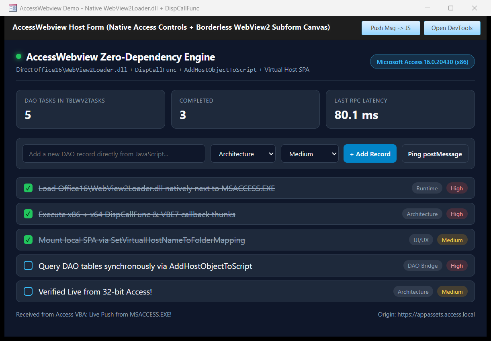

# AccessWebview — Developer Documentation & Reference Guide

`AccessWebview` is a self-contained, **32-bit (`x86`) and 64-bit (`x64`) Microsoft Access VBA WebView2 framework** adapted from [`tarboh/WebView2-For-Excel-VBA`](https://github.com/tarboh/WebView2-For-Excel-VBA) (`v0.5.2`). It drives the native `WebView2Loader.dll` shipped inside `Microsoft Office\root\Office16\` alongside `MSACCESS.EXE` using `oleaut32!DispCallFunc`, `SAFEARRAY` pointer primitives, and dual-architecture (`x86` / `x64`) `VBE7.DLL`-guarded machine-code callback thunks.

It requires **zero COM/ActiveX registration**, **zero VBA Tools -> References** beyond standard Access defaults, **zero admin privileges**, and **zero `MSysResources` Trusted Domains configuration**—unlocking direct `chrome.webview.hostObjects` DAO RPC, event-driven `postMessage`, `SetVirtualHostNameToFolderMapping` local SPA hosting, F12 DevTools, Playwright-style DOM automation, and HTTP request/response capture inside Microsoft Access forms.



---

## Table of Contents

1. [Directory Layout & Module Inventory](#1-directory-layout--module-inventory)
2. [Installation & Integration Guide](#2-installation--integration-guide)
3. [Quick-Start Recipes](#3-quick-start-recipes)
4. [Architecture Overview](#4-architecture-overview)
5. [Low-Level COM & Callback Thunk Internals (`Wv2Thunks` & `ComCallbackHandler`)](#5-low-level-com--callback-thunk-internals-wv2thunks--comcallbackhandler)
6. [Access Windowing & Form Lifecycle (`clsWv2Host`, `modWv2AccessHost` & `frmWv2Surface`)](#6-access-windowing--form-lifecycle-clswv2host-modwv2accesshost--frmwv2surface)
7. [Core Browser & Viewport API Reference (`Wv2Environment` & `Wv2Pane`)](#7-core-browser--viewport-api-reference-wv2environment--wv2pane)
8. [JavaScript <-> Access VBA / DAO IPC Patterns](#8-javascript---access-vba--dao-ipc-patterns)
9. [DOM Automation & SPA Quiescence API (`Wv2Element` & `Wv2Pane` D-Axis)](#9-dom-automation--spa-quiescence-api-wv2element--wv2pane-d-axis)
10. [Network Traffic Inspection & Capture API (`Wv2Pane` N-Axis)](#10-network-traffic-inspection--capture-api-wv2pane-n-axis)
11. [Multi-Tab Management & Deferred Timers (`Wv2Browser`, `SafeTimer`, `LibTimers`)](#11-multi-tab-management--deferred-timers-wv2browser-safetimer-libtimers)
12. [32-Bit (`x86`) vs. 64-Bit (`x64`) ABI & Edge-Case Guarantees](#12-32-bit-x86-vs-64-bit-x64-abi--edge-case-guarantees)
13. [Comparison: `AccessWebview` vs. Native Access `EdgeBrowserControl`](#13-comparison-accesswebview-vs-native-access-edgebrowsercontrol)
14. [Diagnostics, Logging (`Wv2Log`), Testing & Troubleshooting](#14-diagnostics-logging-wv2log-testing--troubleshooting)

---

## 1. Directory Layout & Module Inventory

### Repository Files

| File / Folder | Purpose |
|---|---|
| [`./AccessWebview.accdb`](./AccessWebview.accdb) | Reference host database (compiled & verified in 32-bit `MSACCESS.EXE` `16.0.20430.20180`; compatible with 64-bit Access) |
| [`./spa/index.html`](./spa/index.html) | Sample dark-mode SPA mounted at `https://appassets.access.local/index.html` demonstrating `hostObjects.vba` DAO CRUD + bidirectional `postMessage` |
| [`./src/`](./src) | Exported 7-bit ASCII VBA source for all 17 modules, classes, and Access forms (managed via XLIDE) |
| [`./AccessWebview-Live-Verified.png`](./AccessWebview-Live-Verified.png) | Live screenshot of `frmWv2Demo` running in 32-bit Microsoft Access |
| [`./README.md`](./README.md) / [`./README.html`](./README.html) | Developer documentation (Markdown & standalone HTML) |

### VBA Module Inventory (`src/`)

Depending on whether you are building a **single-pane Access SPA** or a **multi-tab automation browser**, you can import either the **Lean SPA Core (10 objects, plus `SafeTimer` & `LibTimers`)** or the **Full Suite (17 objects)**:

| Module / Form | Type | Tier | Lines | Responsibility |
|---|---|---|---:|---|
| [`Wv2Thunks.bas`](./src/Wv2Thunks.bas) | Standard | **Core** | 2,716 | `WebView2Loader.dll` declaration, `DispCallFunc` (`dcf`), `VirtualAlloc` 512-slot callback pool, `x86`/`x64` machine-code thunks, IID table, `SAFEARRAY` memory primitives, and VBE Reset Sentinel |
| [`ComCallbackHandler.cls`](./src/ComCallbackHandler.cls) | Class | **Core** | 166 | Receives all 13 `HandlerKind` COM callbacks at fixed vtable slot 7 (`Handler_Invoke`) and routes them to owner classes |
| [`Wv2Environment.cls`](./src/Wv2Environment.cls) | Class | **Core** | 255 | Asynchronous `ICoreWebView2Environment` bootstrapper and COM pointer lifetime wrapper |
| [`Wv2Pane.cls`](./src/Wv2Pane.cls) | Class | **Core** | 8,006 | `ICoreWebView2Controller` + `ICoreWebView2` / `_2` / `_3` wrapper, `EvalSync`, DOM queries, quiescence probes, and network capture |
| [`Wv2Element.cls`](./src/Wv2Element.cls) | Class | **Core** | 489 | Generation-checked DOM element handle (`InnerText`, `InnerHTML`, `Value`, `Click`, `GetAttribute`, `SetAttribute`) |
| [`Wv2Json.bas`](./src/Wv2Json.bas) | Standard | **Core** | 373 | Pure-VBA JSON escaping, unescaping (including UTF-16 surrogate pairs), and lightweight key extraction |
| [`Wv2Log.bas`](./src/Wv2Log.bas) | Standard | **Core** | 514 | Sequenced UTF-8 file logger (`%APPDATA%\Wv2Browser\logs`) with automatic log rotation |
| [`clsWv2Host.cls`](./src/clsWv2Host.cls) | Class | **Core** | 167 | Persistent Access WebView2 controller host that survives Access Subform (`OFormChild`) recreation during grow/maximize resizes |
| [`modWv2AccessHost.bas`](./src/modWv2AccessHost.bas) | Standard | **Core** | 440 | Access `OFormSub` / `OFormChild` HWND resolver, `clsWv2Host` registry, Z-order sync, and 4-step self-test suite |
| [`Form_frmWv2Surface.cls`](./src/Form_frmWv2Surface.cls) | Form | **Core** | 129 | Reusable borderless Access Subform canvas (`InitSpa`, `ResizeViewport`, `ShutdownWebView`) backed by `clsWv2Host` |
| [`clsWv2AccessBridge.cls`](./src/clsWv2AccessBridge.cls) | Class | App | 152 | Example DAO RPC bridge exposed to JavaScript as `window.chrome.webview.hostObjects.vba` |
| [`Form_frmWv2Demo.cls`](./src/Form_frmWv2Demo.cls) | Form | App | 106 | Example Access host form combining native Access header controls with `frmWv2Surface` |
| [`Wv2Browser.cls`](./src/Wv2Browser.cls) | Class | Multi-Tab | 2,860 | Multi-tab controller, tab events, and `put_NewWindow` prewarmed popup tab delegation |
| [`SafeTimer.cls`](./src/SafeTimer.cls) | Class | Multi-Tab | 90 | Break-safe Win32 timer backed by a message-only window (`HWND_MESSAGE = -3`) for deferred async actions outside WebView2 callbacks |
| [`LibTimers.bas`](./src/LibTimers.bas) | Standard | Multi-Tab | 127 | `x86` + `x64` VBE7 `EntryPoint` timer callback thunk for `SafeTimer` |
| [`Wv2Url.bas`](./src/Wv2Url.bas) | Standard | Multi-Tab | 155 | UTF-8 percent-encoding (`UrlEncodeComponent`) and URL scheme helpers |
| [`Wv2SettingsBridge.cls`](./src/Wv2SettingsBridge.cls) | Class | Multi-Tab | 654 | Search-engine preset persistence helper used by `Wv2Browser` |

---

## 2. Installation & Integration Guide

### Runtime Prerequisites (Already Present on Modern Windows + Office)

1. **Microsoft Access 2016 / 2019 / 2021 / LTSC / Microsoft 365** (`32-bit x86` or `64-bit x64`).
2. **`WebView2Loader.dll`:** Automatically resolved from `Microsoft Office\root\Office16\WebView2Loader.dll` (installed right beside `MSACCESS.EXE`, so Windows loads the exact matching `x86` or `x64` binary first under standard DLL search order).
3. **Microsoft Edge WebView2 Evergreen Runtime:** Pre-installed on Windows 10 (21H2+) and Windows 11 (`C:\Program Files (x86)\Microsoft\EdgeWebView\Application`).

> **Zero External References:** Only the standard built-in Access VBA references (`VBA`, `Access`, `stdole`, and `DAO` if your bridge queries tables) are needed. Do **not** add references to `Microsoft Internet Controls`, `Microsoft HTML Object Library`, or any `.tlb` / `.dll`.

### Integrating into an Existing `.accdb` Application

1. **Import the Core Modules:**  
   Copy or import `Wv2Thunks`, `ComCallbackHandler`, `Wv2Environment`, `Wv2Pane`, `Wv2Element`, `Wv2Json`, `Wv2Log`, `SafeTimer`, `LibTimers`, `clsWv2Host`, `modWv2AccessHost`, and the reusable form **`frmWv2Surface`** from `AccessWebview.accdb` into your front-end `.accdb` (*External Data -> New Data Source -> From Database -> Access*).
2. **Drop `frmWv2Surface` onto Your Host Form:**  
   - Open your host form in Design View and add a **Subform/Subreport** control named `subWebView` with `SourceObject = "frmWv2Surface"`, `BorderStyle = Transparent (0)`.
   - If using Access layout anchoring, set `HorizontalAnchor = Both` and `VerticalAnchor = Both`—or resize `Me.subWebView` explicitly in `Form_Resize` (recommended for pixel-tight full-bleed layouts).
3. **Create Your Bridge Class:**  
   Create a standard VBA class module (e.g., `clsAppBridge`) with `Public Function` / `Public Sub` methods. Every VBA class automatically implements `IDispatch`, so WebView2 exposes its `Public` members directly to JavaScript when passed to `InitSpa` or `View_AddHostObjectToScript`.
4. **Compile Before First Run:**  
   In the VBA Editor (`Alt+F11`), click **Debug -> Compile `<ProjectName>`** and save. Compiling ensures all standard-module `AddressOf` function pointers (`Handler_QueryInterface`, `Handler_AddRef`, `Handler_Release`, `EntryPoint`) are materialized before Win32 APIs invoke them.

---

## 3. Quick-Start Recipes

### Recipe 1: Full Local SPA with Synchronous/Async DAO Bridge (`frmWv2Surface`)

Place your `index.html`, `.js`, and `.css` assets in a local folder (e.g., `CurrentProject.Path & "\spa"`). Inside your Access host form:

```vba
Option Compare Database
Option Explicit

Private m_bridge As clsWv2AccessBridge

Private Sub Form_Load()
    Set m_bridge = New clsWv2AccessBridge

    Dim surf As Form_frmWv2Surface
    Set surf = Me.subWebView.Form

    ' Mounts folder at https://appassets.access.local/index.html and attaches m_bridge as hostObjects.vba
    If Not surf.InitSpa( _
        virtualHostName:="appassets.access.local", _
        localFolderPath:=CurrentProject.Path & "\spa", _
        entryFile:="index.html", _
        hostObject:=m_bridge, _
        hostObjectName:="vba") Then
        MsgBox "WebView2 failed to initialize.", vbExclamation
    End If
End Sub

Private Sub Form_Resize()
    On Error Resume Next
    Me.subWebView.Move 0, 0, Me.InsideWidth, Me.InsideHeight - Me.FormHeader.Height
    Me.subWebView.Form.ResizeViewport
    On Error GoTo 0
End Sub

Private Sub Form_Unload(Cancel As Integer)
    On Error Resume Next
    Me.subWebView.Form.ShutdownWebView
    Set m_bridge = Nothing
    On Error GoTo 0
End Sub
```

Inside your JavaScript (`spa/index.html`):

```javascript
// Asynchronous call (non-blocking Promise — preferred for UI responsiveness)
const tasksJson = await window.chrome.webview.hostObjects.vba.GetTasksJson();
const tasks = JSON.parse(tasksJson);

// Synchronous call (blocks JS until VBA returns)
const hostJson = window.chrome.webview.hostObjects.sync.vba.GetHostInfoJson();
```

### Recipe 2: Self-Contained Inline HTML (`View_NavigateToString` — Zero External Files)

When you want to render charts, Markdown previews, or interactive cards from HTML generated purely in VBA without writing files to disk:

```vba
Public Sub LoadInlineHtmlCard(ByVal surf As Form_frmWv2Surface)
    Dim env As New Wv2Environment
    env.Init GetDefaultUserDataFolder()
    Do While Not env.IsReady And Not env.IsFailed: DoEvents: Loop

    Dim pane As New Wv2Pane
    pane.Init env, GetAccessFormCanvasHwnd(surf)
    Do While Not pane.IsReady And Not pane.IsFailed: DoEvents: Loop

    pane.Ctrl_GetCoreWebView2
    pane.View_AddNavigationCompleted
    pane.View_AddWebMessageReceived

    Dim rc As RECT
    GetClientRect GetAccessFormCanvasHwnd(surf), rc
    pane.Ctrl_PutBounds rc
    pane.Ctrl_PutIsVisible True

    pane.View_NavigateToString _
        "<!doctype html><html><body style='font-family:Segoe UI;padding:20px'>" & _
        "<h2>Inline Access Report</h2>" & _
        "<button onclick=""chrome.webview.postMessage('export-clicked')"">Export</button>" & _
        "</body></html>"
End Sub
```

> **Note:** `View_NavigateToString` has an `about:blank` origin and a ~2 MB string limit. Whenever your app uses ES modules (`<script type="module">`), `fetch()` to local assets, `localStorage`, or `history.pushState` routing, use `InitSpa` / `View3_SetVirtualHostNameToFolderMapping` instead so your app runs under a genuine secure `https://` origin.

### Recipe 3: Automated Web Driving & React/Vue Form Filling (`Wv2Element` + `WaitSettled`)

```vba
Public Sub AutomatePortalSearch(ByVal p As Wv2Pane, ByVal queryText As String)
    p.View_Navigate "https://example.org"

    ' 1. Wait up to 10s for an input element to appear in the DOM
    Dim searchBox As Wv2Element
    Set searchBox = p.WaitFor("#search-input", 10)
    If searchBox Is Nothing Then Exit Sub

    ' 2. Arm a network or URL signal BEFORE triggering the UI action
    p.ArmNetworkSignal "/api/search"

    ' 3. Assign .value (uses native HTMLInputElement prototype setter so React/Vue state updates!)
    searchBox.value = queryText
    p.QuerySelector("#submit-btn").Click

    ' 4. Wait until in-flight fetch/XHR + DOM mutations settle
    If p.WaitSettled(timeoutSec:=15, quietMs:=400) Then
        Dim rows As Collection
        Set rows = p.QuerySelectorAll(".result-item")
        Dim item As Wv2Element
        For Each item In rows
            Debug.Print item.InnerText
        Next item
    End If
End Sub
```

---

## 4. Architecture Overview

`AccessWebview` is structured in five strict layers so low-level pointer/thunk mechanics never leak into form or business logic:

```text
+----------------------------------------------------------------------------------------+
| Layer 5: Access Application & UI Layer                                                 |
|   frmWv2Demo (Host Form)  |  clsWv2AccessBridge (DAO / Business Logic via IDispatch)   |
+----------------------------------------------------------------------------------------+
| Layer 4: Reusable Access Host Surface                                                  |
|   frmWv2Surface (Borderless Subform)  |  modWv2AccessHost (OFormSub HWND & Test Suite) |
+----------------------------------------------------------------------------------------+
| Layer 3: High-Level Browser, DOM & Network Abstractions                                |
|   Wv2Element (DOM Handle)  |  Wv2Browser (Multi-Tab + Prewarm)  |  Wv2Json / Wv2Log    |
+----------------------------------------------------------------------------------------+
| Layer 2: Core WebView2 COM Wrappers                                                    |
|   Wv2Environment (ICoreWebView2Environment)                                            |
|   Wv2Pane (ICoreWebView2Controller + ICoreWebView2 / _2 / _3 + IStream + Headers)      |
+----------------------------------------------------------------------------------------+
| Layer 1: Zero-Reference COM Dispatch & Dual-Bitness Callback Thunk Pool                |
|   Wv2Thunks.bas (DispCallFunc, SAFEARRAY PointerAccessor, VirtualAlloc 512-Slot Pool,  |
|                  VBE7 EbMode Stub + x86/x64 Machine-Code Thunks, Reset Sentinel)       |
|   ComCallbackHandler.cls (Fixed Slot-7 Handler_Invoke Router for 13 HandlerKinds)      |
+----------------------------------------------------------------------------------------+
| Native OS / Office Binaries (Pre-Installed — Zero Registration)                        |
|   Office16\WebView2Loader.dll  -->  EdgeWebView\...\EmbeddedBrowserWebView.dll         |
+----------------------------------------------------------------------------------------+
```

---

## 5. Low-Level COM & Callback Thunk Internals (`Wv2Thunks` & `ComCallbackHandler`)

### 5.1 Outbound VTable Calls via `dcf` (`DispCallFunc`)

WebView2 exposes pure C++ `IUnknown`-derived vtable interfaces (`ICoreWebView2`, `ICoreWebView2Controller`, etc.) rather than late-bound `IDispatch` interfaces, and its type library is not registered in the Windows Registry. `Wv2Thunks.dcf` invokes any COM method directly by **0-based vtable index** (`0 = QueryInterface`, `1 = AddRef`, `2 = Release`, `3+ = interface methods`):

```vba
Public Function dcf( _
    ByVal pInterface As LongPtr, _
    ByVal vtblIndex As Long, _
    ByVal funcName As String, _
    ParamArray args() As Variant) As Long
```

**Argument Marshaling Rules in `dcf`:**
- `vbLong` -> passed as 4-byte integer (`VT_I4`).
- `vbDouble` -> passed as 8-byte IEEE float (`VT_R8`).
- `vbCurrency` -> passed as **8-byte raw 64-bit integer value (`VT_CY`) on both `x86` and `x64`** (used for `EventRegistrationToken` in `remove_*` calls and `LARGE_INTEGER` offsets in `IStream::Seek`).
- `vbLongLong` (on `Win64`) -> passed as 8-byte `LongPtr` (`VT_I8`).
- `Else` fallback -> `vbLongLong` on `Win64`, `vbLong` on `32-bit x86`.
- **Out-Pointers (`[out] void**`, `[out] LPWSTR*`):** Pass `VarPtr(localVar)`. Strings returned by WebView2 (`LPWSTR*`) are copied into a VBA `BSTR` via `PtrToString` and freed immediately via `ole32!CoTaskMemFree` (`GetStringProperty` handles all three steps automatically).
- **Return Value Contract:** `dcf` does **not** assume non-zero means failure, because `IUnknown::AddRef` and `Release` return `ULONG` reference counts (`1, 2, ...`) rather than `HRESULT`s. Callers check `hr <> 0` on `HRESULT`-returning methods.

### 5.2 Inbound Callback Pool (`VirtualAlloc` + `VBE7` `EbMode` Gate + Machine-Code Thunk)

Every asynchronous WebView2 operation (`CreateCoreWebView2EnvironmentWithOptions`, `CreateCoreWebView2Controller`, `ExecuteScript`, `GetContent`, and all 9 browser events) requires the host to supply a custom COM callback object whose vtable is:
- `Slot 0`: `QueryInterface(this, riid, ppvObject)`
- `Slot 1`: `AddRef(this)`
- `Slot 2`: `Release(this)`
- `Slot 3`: `Invoke(this, arg1, arg2)`

Because a VBA class module's vtable places `IDispatch` in slots `3..6`, puts its first user method at **slot 7**, expects `ObjPtr(instance)` as hidden `arg0`, and returns `Function` results through a hidden trailing `HRESULT*` out-parameter, `Wv2Thunks.Thunks_Init` allocates a single `114,752`-byte `PAGE_EXECUTE_READWRITE` region containing a 64-byte header (byte `0` = pool alive flag) plus **512 reusable 224-byte callback slots**:

```text
Slot Layout (224 bytes per slot; pVTableObj = pSlot + 176 passed to WebView2 as `this`):
  +0..+90    : Cloned VBE7 EntryPoint stub (checks VBE7!EbMode; skips call in VBE Break mode!)
                 * x64: 91 bytes, jump target patched at +55 (LATE_BIND_OFFSET = 55)
                 * x86: 33 bytes, jump target patched at +22 (LATE_BIND_OFFSET = 22),
                        Break-mode epilogue at +28 patched from `C2 00 00` -> `C2 0C 00`!
  +96..+169  : Per-slot Machine-Code Thunk
                 * Checks [pRegionBase] == 1 (returns S_OK = 0 immediately if Shutdown/Reset occurred)
                 * Shifts (this, arg1, arg2), injects ObjPtr(ComCallbackHandler), allocates retval,
                   and calls ComCallbackHandler.Handler_Invoke (vtable slot 7)
  +176..+215 : Embedded COM Object + VTable (`VTABLE_OBJ_OFFSET = 176`)
                 * +176           : pVTable -> points to +184
                 * +184 + 0*Ptr   : AddressOf Handler_QueryInterface (checks IID_IUnknown + m_iidTable(kind))
                 * +184 + 1*Ptr   : AddressOf Handler_AddRef         (increments ComCallbackHandler.RefCount)
                 * +184 + 2*Ptr   : AddressOf Handler_Release        (at RefCount=0, breaks owner cycle & frees slot)
                 * +184 + 3*Ptr   : pSlot                            (Invoke -> VBE7 stub -> Machine-Code Thunk)
```

> **Invariant on `ComCallbackHandler.cls`:** `Public Function Handler_Invoke(...)` **must remain the very first procedure/property** in `ComCallbackHandler.cls` (above all `Friend` properties/subs) so its vtable index is guaranteed to be **slot 7** on both 32-bit and 64-bit VBA.

### 5.3 Zero-`CopyMemory` `SAFEARRAY` Primitives & VBE Reset Sentinel

- **`PointerAccessor` (`MemLongPtr` / `ReadLongPtr`):** Instead of calling `kernel32!RtlMoveMemory` on every pointer read/write (which triggers P/Invoke overhead and `Err.LastDllError` side effects), `Wv2Thunks` overlays a 1-element `SAFEARRAY_1D` (`FADF_AUTO Or FADF_FIXEDSIZE`) onto a typed `LongPtr()` array for native memory speed.
- **VBE Reset Sentinel (`WV2_VBA_LastRegion`):** Pressing the VBE **Reset (Stop)** button wipes all VBA module variables (`m_pRegionBase = 0`) without firing `Form_Unload`, leaving the `VirtualAlloc` region orphaned in `MSACCESS.EXE`. `Thunks_Init` stores `m_pRegionBase` in process environment variable `WV2_VBA_LastRegion`. On the next initialization after a VBE Reset, `Sentinel_RecoverIfNeeded` inspects the address via `VirtualQuery` (`MEM_COMMIT` + matching `AllocationBase` + read/write protection), zeroes the alive byte at `+0` so any stray WebView2 callback safely returns `S_OK`, and frees the previous block with `VirtualFree(..., MEM_RELEASE)`.

---

## 6. Access Windowing & Form Lifecycle (`clsWv2Host`, `modWv2AccessHost` & `frmWv2Surface`)

### 6.1 The Two Access Windowing Traps (`3-OFormSub` Z-Order & Subform `OFormChild` Recreation on Grow)

In Excel, `MSForms` UserForms host WebView2 inside a `Frame` control (`Frame1.[_GethWnd]`). In Microsoft Access, **native controls (`Rectangle`, `TextBox`, `CommandButton`, `TabControl`) are windowless** and have no `HWND`. Only **Forms** (`OForm` / `OFormPopup`) and **Subforms** (`OFormChild`) own real Win32 windows:

```text
OFormPopup / OForm (Parent Form.hwnd — IMMORTAL across all resizes)
 ├── 1st OFormSub : FormHeader  <-- Height is 0 px when the form has no header!
 ├── 2nd OFormSub : Detail      <-- IMMORTAL section canvas (never recreated on resize!)
 │     └── OFormChild (Subform.Form.hwnd) <-- EPHEMERAL! Destroyed & reloaded whenever Subform grows!
 └── 3rd OFormSub : FormFooter  <-- Height is 0 px when the form has no footer!
```

Hosting WebView2 reliably in Access requires solving **two distinct Access windowing behaviors**:

1. **Trap #1 — The `0 px` `FormHeader` `OFormSub`:**  
   Access always creates **three** `OFormSub` children under every `Form.hwnd` (`FormHeader`, `Detail`, `FormFooter`). Calling `FindWindowExW(frm.hwnd, 0, StrPtr("OFormSub"), 0)` on a headerless form returns the **1st `OFormSub` (`FormHeader`, height = `0 px`)**, clipping `Chrome_WidgetWin_0` to `0 px` height!
2. **Trap #2 — Subform `OFormChild` Destruction & VBA Reload When Growing/Maximizing:**  
   Whenever an Access `Subform` control (`OFormChild`) **grows larger than its previous high-water size** (dragging a window edge outward or clicking Maximize), Microsoft Access **destroys the `OFormChild` Win32 window, fires `Subform.Form_Unload`, creates a brand-new `OFormChild` `HWND`, and instantiates a fresh VBA `Form_frmWv2Surface` instance!**
   - If `ICoreWebView2Controller` were parented inside `OFormChild`, Win32 `DestroyWindow` would recursively destroy `Chrome_WidgetWin_0`, turning the WebView blank permanently!
   - If `m_pane` lived directly on `Form_frmWv2Surface`, `Form_Unload` would close `m_pane` and the newly created `Form_frmWv2Surface` would wake up with `m_pane Is Nothing`!

`AccessWebview` solves both traps transparently via **`clsWv2Host`** + **`modWv2AccessHost`**:
- When `frmWv2Surface` is hosted inside a Subform (`GetWinClassName(Me.hwnd) = "OFormChild"`), `GetAccessFormCanvasHwnd` returns **`GetParent(Me.hwnd)`**—the parent form's **immortal section `OFormSub`**, which is never destroyed during shrink, grow, maximize, or restore.
- `clsWv2Host` owns `m_env` and `m_pane` outside the ephemeral subform instance and registers itself in `modWv2AccessHost` keyed by `hostHwnd`. When Access reloads `Form_frmWv2Surface` during a grow resize, `EnsureHost()` seamlessly reconnects the new subform instance to the live `clsWv2Host`, maps the subform's screen bounds into `hostHwnd` client pixels via `MapWindowPoints`, calls `Ctrl_PutBounds` + `Ctrl_NotifyParentWindowPositionChanged`, and keeps `Chrome_WidgetWin_0` at `HWND_TOP` (`SyncAccessWebViewZOrder`).

### 6.2 Subform Design Width, Section Height Ordering & DPI-Free Pixel Resizing

1. **Keep `frmWv2Surface.Width` Small in Design View (`1440` twips = 1 inch):**  
   If an Access subform's Design-View `Width` is wider than `subWebView.Width`, Access forces the inner `OFormChild` width to `Max(subWebView.Width, frmWv2Surface.Width)`. Keeping `frmWv2Surface.Width = 1440` and `Detail.Height = 1440` lets `frmWv2Surface` shrink or expand to any container size cleanly.
2. **Expand `Detail.Height` Before `subWebView.Height` When Resizing in VBA:**  
   If resizing `subWebView` in `Form_Resize`, Access rejects `subWebView.Height = targetH` if `targetH > Me.Detail.Height`. Expand `Me.Detail.Height` *first* when growing, and shrink `Me.subWebView.Height` *first* when shrinking (as shown in `Form_frmWv2Demo.RefreshHeaderAndViewport`).
3. **Never Convert Twips to Pixels Manually:**  
   `GetAccessFormViewportRect` uses Win32 `GetWindowRect` + `MapWindowPoints` / `GetClientRect` directly in physical pixels, avoiding Twips-to-Pixels rounding drift across 100%, 125%, 150%, and Per-Monitor DPI v2 displays.

### 6.3 Double-Safe Deterministic Teardown (`Form_Unload` & `SafeTimer` Orphan Check)

- **Explicit Teardown:** In your parent form's `Form_Unload`, call `Me.subWebView.Form.ShutdownWebView` and `ShutdownAccessFormWebViews Me` (which tears down any `clsWv2Host` attached to the form's `OFormSub` sections even if Access unloaded the subform first during a Form View -> Design View switch).
- **Automatic Orphan Safety Net:** Whenever `frmWv2Surface.Form_Unload` fires on a subform, `clsWv2Host.ScheduleOrphanCheck` arms an 80 ms one-shot `SafeTimer`. If `Form_Unload` was merely a resize-triggered `OFormChild` swap, `IsWindow(m_hostHwnd)` is still non-zero and the WebView continues uninterrupted; if the parent form actually closed (even without parent `Form_Unload` code), `IsWindow(m_hostHwnd)` is `0` and `clsWv2Host.Shutdown` releases all WebView2 COM pointers (`View3 -> View2 -> View -> Controller -> Environment`) automatically.

---

## 7. Core Browser & Viewport API Reference (`Wv2Environment` & `Wv2Pane`)

### `Wv2Environment` (`src/Wv2Environment.cls`)

| Member | Signature | Description |
|---|---|---|
| `Init` | `Sub Init(ByVal userDataPath As String)` | Calls `CreateCoreWebView2EnvironmentWithOptions` asynchronously. Creates `userDataPath` recursively if missing (defaults to `C:\Temp\VBA_WebView2`; `modWv2AccessHost.GetDefaultUserDataFolder()` returns `%LOCALAPPDATA%\AccessWebview\UserData`). |
| `IsReady` / `IsFailed` | `Property Get () As Boolean` | Poll with `DoEvents` until `IsReady` or `IsFailed` becomes `True`. |
| `LastError` | `Property Get () As Long` | `HRESULT` if initialization failed (`0` = `S_OK`). |
| `EnvironmentPtr` | `Property Get () As LongPtr` | Raw `ICoreWebView2Environment*` COM interface pointer. |

### `Wv2Pane` — Lifecycle, Navigation & Settings (`src/Wv2Pane.cls`)

| Category | Method / Property | Description |
|---|---|---|
| **Controller** | `Init(env, hwnd)` | Asynchronously creates `ICoreWebView2Controller` parented to `hwnd`. |
| | `IsReady` / `IsFailed` / `LastError` | Readiness state of controller creation. |
| | `Ctrl_GetCoreWebView2() As Long` | Populates internal `m_pView` (`ICoreWebView2*`); call once immediately after `IsReady = True`. |
| | `Ctrl_PutBounds(bounds As RECT) As Long` | Resizes browser viewport in parent client pixels (`x86` 4-`Long` stack ABI & `x64` pointer ABI handled automatically). |
| | `Ctrl_PutIsVisible(visible As Boolean) As Long` | Shows or hides the controller viewport (`True` normalized to Win32 `BOOL = 1`). |
| | `Ctrl_Close() As Long` | Closes controller, zeroes persistent tokens, and prevents further script calls. |
| **Navigation** | `View_Navigate(url As String) As Long` | Navigates to an `https://`, `http://`, `file:///`, or virtual-host URL. |
| | `View_NavigateToString(htmlContent As String) As Long` | Renders an in-memory HTML string directly (`about:blank` origin). |
| | `View3_SetVirtualHostNameToFolderMapping(hostName, folderPath, accessKind) As Long` | Maps `https://<hostName>/` to a local folder (`0 = DENY`, `1 = ALLOW`, `2 = DENY_CORS`). Always navigate to an explicit file (e.g., `index.html`), as root `/` returns `ACCESS_DENIED`. |
| | `View_Reload()` / `View_Stop()` | Reloads current page or cancels in-progress navigation. |
| | `View_GoBack()` / `View_GoForward()` | Navigates session history (`View_GetCanGoBack` / `View_GetCanGoForward` check availability). |
| | `View_GetSource()` / `View_GetDocumentTitle()` | Returns current URL or `<title>` string. |
| **Settings & DevTools** | `Settings_PutAreDevToolsEnabled(v As Boolean) As Long` | Enables or disables F12 / programmatic DevTools. |
| | `View_OpenDevToolsWindow() As Long` | Opens the Chromium DevTools inspector window (`ICoreWebView2` vtable 51). |
| | `Settings_PutAreDefaultContextMenusEnabled(v As Boolean) As Long` | Enables or suppresses the right-click browser context menu (set `False` for locked-down production Access apps). |
| | `Settings_PutIsScriptEnabled(v As Boolean) As Long` | Enables or disables JavaScript execution on subsequent navigations. |
| **Events** | `View_AddNavigationStarting` / `View_AddNavigationCompleted` | Subscribes to navigation lifecycle (`IsPageLoaded` tracks completion). |
| | `View_AddDocumentTitleChanged` / `View_AddHistoryChanged` | Tracks `<title>` updates and SPA `pushState` / `replaceState` / `popstate` URL transitions. |
| | `View2_AddDOMContentLoaded` | Subscribes to `ICoreWebView2_2::DOMContentLoaded` (fires before external images/subresources finish). |
| | `View_AddWebMessageReceived` | Enables `Public Event WebMessageReceived(messageText, messageJson)` and optional `SetWebMsgSink` forwarding. |
| | `View_AddNewWindowRequested` | Intercepts `window.open` / `target="_blank"` links (`Wv2Browser` routes them into prewarmed tabs, preserving `POST` bodies and headers). |

---

## 8. JavaScript <-> Access VBA / DAO IPC Patterns

`AccessWebview` supports three complementary communication channels between JavaScript and Access VBA:

### Pattern A: Direct Host Object RPC (`AddHostObjectToScript`) — *Recommended for SPA CRUD*

Register any VBA class instance **before** calling `View_Navigate` / `View_NavigateToString`:

```vba
Set m_bridge = New clsWv2AccessBridge
m_pane.View_AddHostObjectToScript "vba", m_bridge
```

JavaScript can invoke any `Public Function`, `Public Sub`, or `Public Property` on `clsWv2AccessBridge`:

```javascript
// 1. Async Proxy (Recommended — returns a Promise without freezing UI animations)
const updatedJson = await window.chrome.webview.hostObjects.vba.AddTask("Audit Q4", "Finance", "High");

// 2. Sync Proxy (Blocks JS until VBA returns; avoid calling EvalSync back into the same pane!)
const pong = window.chrome.webview.hostObjects.sync.vba.Ping("Hello");
```

> **DAO Performance Best Practice in Split Access Databases:**  
> When your Access front-end links to a shared network back-end `.accdb`, keep a persistent back-end `DAO.Database` handle open in your data service (`clsDb` / `OpenDatabase(backEndPath)`) and run SQL / `OpenRecordset` against that back-end handle inside your bridge methods rather than `CurrentDb` linked tables. Combined with `hostObjects.vba`, DAO reads/writes complete in **< 10–80 ms** with zero timer-polling latency.

### Pattern B: Asynchronous Event Push (`postMessage` <-> `WebMessageReceived`)

Ideal for fire-and-forget notifications, streaming progress updates, or decoupled command buses:

- **VBA -> JS (`View_PostWebMessageAsString`):**
  ```vba
  m_pane.View_PostWebMessageAsString "{""event"":""recordSaved"",""id"":42}"
  ```
  ```javascript
  window.chrome.webview.addEventListener('message', (ev) => {
      const msg = JSON.parse(ev.data);
      console.log('Pushed from Access:', msg);
  });
  ```
  *(Ensure the page has finished `NavigationCompleted` or sent a `"ready"` message first; messages sent before JS registers its listener are dropped by WebView2.)*

- **JS -> VBA (`window.chrome.webview.postMessage`):**
  ```javascript
  window.chrome.webview.postMessage(JSON.stringify({ cmd: 'openReport', name: 'rptInvoice' }));
  ```
  ```vba
  Private WithEvents m_pane As Wv2Pane

  Private Sub m_pane_WebMessageReceived(ByVal messageText As String, ByVal messageJson As String)
      ' messageText is populated when JS passes a String; messageJson is always populated as JSON!
      Debug.Print "Received from JS: " & messageText
  End Sub
  ```

### Pattern C: Synchronous JS Evaluation from VBA (`EvalSync`)

`Wv2Pane.EvalSync(jsExpr, Optional timeoutSec = 5)` wraps `jsExpr` inside a `try { ... } catch` + `JSON.stringify(...)` envelope, dispatches `ICoreWebView2::ExecuteScript`, pumps `DoEvents` until `HK_ExecuteScriptCompleted` arrives for that `callbackId`, unescapes the returned JSON string (including `<` `\u003C` escapes and UTF-16 surrogate pairs), and sets `LastEvalOk` / `LastEvalError`:

```vba
Dim countStr As String
countStr = p.EvalSync("document.querySelectorAll('.task-row').length")
If p.LastEvalOk Then
    Debug.Print "Rendered rows: " & CLng(countStr)
Else
    Debug.Print "Eval failed: " & p.LastEvalError
End If
```

> **Critical Re-Entrancy Rule (`m_inCallback` Guard):**  
> Never call `EvalSync`, `WaitFor`, or `Wv2Element` methods synchronously *inside* a `WebMessageReceived` or `NavigationCompleted` event handler. WebView2 holds its callback thread until `Handler_Invoke` returns, so blocking inside the handler for `ExecuteScriptCompleted` would deadlock. `Wv2Pane` detects `m_inCallback > 0` and returns immediately with `LastEvalError = "in-callback"`. If you need to run `EvalSync` in response to an event, defer it by 10 ms via `SafeTimer` or the Access form's `Me.TimerInterval = 10` (`Form_Timer`).

---

## 9. DOM Automation & SPA Quiescence API (`Wv2Element` & `Wv2Pane` D-Axis)

`Wv2Pane` injects a self-healing element registry (`window.__wv2Reg`) tagged with a per-document generation token (`'g' + Date.now() + '-' + Math.random()`). VBA receives lightweight integer handles wrapped in `Wv2Element` instances—eliminating CSS/JS quote-escaping bugs and automatically detecting stale elements after page navigations.

### Finding & Waiting for Elements (`Wv2Pane`)

| Method / Property | Return Type | Description |
|---|---|---|
| `GetElementById(elementId)` | `Wv2Element` | Finds `#elementId` (waits up to `ImplicitWaitSec` if `> 0`; returns `Nothing` if absent). |
| `QuerySelector(selector)` | `Wv2Element` | Finds first matching CSS selector (`Nothing` if not found; check `LastEvalOk` to distinguish "not found" from errors). |
| `QuerySelectorAll(selector, [maxCount=200])` | `Collection` | Returns a 1-based `Collection` of `Wv2Element` objects (**never `Nothing`**, even when `Count = 0`). |
| `WaitFor(selector, [timeoutSec=10])` | `Wv2Element` | Polls until `selector` exists in the DOM or `timeoutSec` expires. Note: `WaitFor` returns an **object**—check `If p.WaitFor("#id", 10) Is Nothing Then`! |
| `WaitGone(selector, [timeoutSec=10])` | `Boolean` | Polls until `selector` disappears from the DOM (ideal for loading spinners/overlays). |
| `ImplicitWaitSec` | `Single` | Opt-in automatic wait duration (default `0`) applied to `QuerySelector` and `GetElementById`. |

### Inspecting & Manipulating Elements (`Wv2Element`)

| Member | Type | Description |
|---|---|---|
| `.TagName` | `String` (Get) | Uppercase tag name (e.g., `"INPUT"`, `"BUTTON"`). |
| `.InnerText` / `.InnerHTML` | `String` (Get) | Reads rendered text or inner HTML markup. |
| `.value` | `String` (Get/Let) | Reads or sets form control values. **React/Vue-safe:** invokes the native `HTMLInputElement` / `HTMLTextAreaElement` / `HTMLSelectElement` prototype value setter and dispatches bubbling `input` + `change` events. |
| `.Click()` | `Boolean` | Calls `.click()` on the element (`True` if the element was still live in the current DOM generation). |
| `.GetAttribute(name)` / `.SetAttribute(name, val)` | `String` / `Boolean` | Reads or updates HTML attributes. |
| `.IsStale` | `Boolean` (Get) | `True` if the page navigated or the element was removed from the registry. |
| `.LastOk` / `.LastError` | `Boolean` / `String` | Status of the most recent operation on this element (`""`, `"stale"`, `"in-callback"`, etc.). |

### Waiting for SPA Quiescence (`WaitSettled` & Explicit Signals)

Modern SPAs update via `fetch()`, `XMLHttpRequest`, and microtask DOM mutations without firing `NavigationCompleted`. `Wv2Pane` includes an auto-injected SPA probe:

- **`p.WaitSettled([timeoutSec=10], [quietMs=500]) As Boolean`** — Installs/verifies the in-page `fetch` + `XHR` + `MutationObserver` probe and waits until in-flight network requests hit `0` (excluding requests older than `StaleInflightMs`, default `15000 ms`) and no non-ignored DOM mutations occur for `quietMs`.
- **Explicit Signals (Arm *Before* Clicking):**
  - `p.ArmContentSignal(cssSelector)` — `WaitSettled` will not declare success until text inside `cssSelector` changes.
  - `p.ArmNetworkSignal(urlSubstring)` — Waits until at least one matching `fetch`/`XHR` completes.
  - `p.ArmUrlSignal(urlFragment)` — Waits until `location.href` contains `urlFragment`.
- **Noise Filtering:** `p.AddIgnoreNetwork("analytics")` and `p.IgnoreSelectors = ".clock, .toast"` exclude background telemetry or ticking UI timers from blocking `WaitSettled`.

---

## 10. Network Traffic Inspection & Capture API (`Wv2Pane` N-Axis)

`Wv2Pane` can capture live HTTP/HTTPS traffic (`WebResourceRequested` + `ICoreWebView2_2::WebResourceResponseReceived` + `GetContent`)—acting like a programmable F12 Network tab inside Access VBA:

```vba
' 1. Configure capture BEFORE navigating so the initial DOCUMENT request is recorded
p.NetDetailOn = True            ' Capture request headers & request body (IStream)
p.NetRespBodyOn = True          ' Asynchronously capture decompressed response body
p.NetDetailUriFilter = "/api/"  ' Optional substring filter for heavy detail capture
p.NetCaptureStart               ' Default contexts: DOCUMENT, XML_HTTP_REQUEST, FETCH

p.View_Navigate "https://httpbingo.org/get"
p.WaitFor "pre", 10

' 2. Inspect captured entries (1..p.NetLogCount)
Dim i As Long
For i = 1 To p.NetLogCount
    Debug.Print p.NetLogLine(i) & " -> HTTP " & p.NetLogStatus(i)
    Debug.Print p.NetDetailHeaders(i)
    Debug.Print p.NetDetailRespBody(i)
Next i

p.NetCaptureStop
```

**Important Network Capture Guarantees:**
1. **Non-Destructive Request Body Reading:** Reading `ICoreWebView2WebResourceRequest::get_Content` advances the live `IStream` cursor; `Wv2Pane` automatically calls `IStream::Seek(0, STREAM_SEEK_SET, NULL)` afterward so `POST` bodies are never truncated on the wire.
2. **Automatic Secret Redaction:** `NetRedact` defaults to `True`, masking `Cookie`, `Authorization`, `Proxy-Authorization`, and `Set-Cookie` headers in output logs (`AddRedactHeader` adds custom headers).
3. **Virtual Host Traffic Note:** Requests served locally via `SetVirtualHostNameToFolderMapping` bypass Chromium's network stack and therefore do not appear in `WebResourceRequested` (external `https://` / `http://127.0.0.1` calls do).

---

## 11. Multi-Tab Management & Deferred Timers (`Wv2Browser`, `SafeTimer`, `LibTimers`)

- **`Wv2Browser` (`src/Wv2Browser.cls`):** Manages a shared `Wv2Environment` and a 1-based `Collection` of `Wv2Pane` tabs sharing a single host `HWND`. Raises `TabAdded`, `TabClosed`, `ActiveChanged`, `TabTitleChanged`, and `TabUrlChanged` events.
  - **POST-Preserving Popup Capture (`NewWindowMode = 2`):** Prewarms a hidden background `Wv2Pane` (`PREWARM_DELAY_MS = 1500 ms` after `Init`) and hands its `ICoreWebView2*` pointer directly to `ICoreWebView2NewWindowRequestedEventArgs::put_NewWindow`, preserving `POST` payloads, cookies, and `Sec-Fetch-User` headers when sites open new windows.
  - Always call `m_browser.Shutdown` in `Form_Unload` to break the `Wv2Browser <-> Wv2Pane` back-reference before setting `m_browser = Nothing`.
- **`SafeTimer` (`src/SafeTimer.cls`) & `LibTimers` (`src/LibTimers.bas`):**  
  Replaces the upstream Excel `TimerForm.frm` (`MSForms.UserForm`) with a lightweight Win32 **message-only window** (`CreateWindowExW(..., "STATIC", ..., hWndParent:=HWND_MESSAGE)` where `HWND_MESSAGE = -3`) and cleans up deterministically via `KillTimer` + `DestroyWindow` in `Class_Terminate`. `LibTimers.GetTimerProc` patches VBE7's `EntryPoint` stub on both `x64` (`+55`) and `x86` (`+22`, plus `+30` patched to `RET 0x0010` for 4-argument `TIMERPROC` Break-mode safety).

---

## 12. 32-Bit (`x86`) vs. 64-Bit (`x64`) ABI & Edge-Case Guarantees

| Subsystem | 64-Bit (`Win64`) Behavior | 32-Bit (`x86`) Behavior & `AccessWebview` Guarantee |
|---|---|---|
| **`WebView2Loader.dll` Bitness** | Loads 64-bit `C:\Program Files\Microsoft Office\root\Office16\WebView2Loader.dll` | Loads 32-bit `C:\Program Files (x86)\Microsoft Office\root\Office16\WebView2Loader.dll` (undecorated `__stdcall` exports; zero `Alias` changes needed). |
| **`VBE7.DLL` `EntryPoint` Stub** | 91-byte stub; `EbMode` at `+37`, target immediate at `+55`, `C2 00 00` (`RET`) | 33-byte stub; `EbMode` at `+10`, target immediate at `+22`, Break-mode epilogue at `+28` patched from `C2 00 00` to **`C2 0C 00` (`RET 12`)** so Break mode never corrupts `ESP`. |
| **Callback Machine-Code Thunk** | 74-byte MS x64 ABI thunk (`RCX, RDX, R8, R9` + `[RSP+0x20]` retval pointer) | 46-byte `__stdcall` thunk (`CMP [pRegionBase], 1` -> `PUSH 0` retval slot -> pushes `&retval, arg2, arg1, this, pSelfObj` -> `CALL Handler_Invoke` -> `POP EAX` -> `RET 0x000C`). |
| **`ICoreWebView2Controller::put_Bounds(RECT)`** | MS x64 ABI passes 16-byte `RECT` **by pointer** in `RDX` (`VarPtr(bounds)`) | Win32 `x86` `__stdcall` passes 16-byte `RECT` **by value on the stack as 4 `Long`s** (`bounds.Left, bounds.Top, bounds.Right, bounds.Bottom`). Passing `VarPtr` on `x86` produced `0x0` bounds! |
| **`EventRegistrationToken` (`remove_*`) & `IStream::Seek`** | 8-byte `int64` passed in single 64-bit register | Stored as 8-byte **`Currency` (`0@`, `vbCurrency`)** so `DispCallFunc` pushes all 8 bytes onto the `x86` stack by value while `VarPtr(token)` remains valid for `[out] EventRegistrationToken*`. |
| **`ComCallbackHandler` VTable Slot 7** | `Public Function Handler_Invoke` placed after `Friend` members in upstream | Moved `Handler_Invoke` to the **top of `ComCallbackHandler.cls`** above all `Friend` procedures so slot 7 is strictly `Handler_Invoke` in Access VBE. |
| **`ICoreWebView2Environment` VTable** | `3 = CreateCoreWebView2Controller`, `4 = CreateWebResourceResponse`, `5 = get_BrowserVersionString` | Verified against `Microsoft.Web.WebView2.Core.dll` metadata: `get_BrowserVersionString` is **vtable index 5** (calling slot 4 with 1 arg faults `combase.dll` on `x86` stack mismatch). |
| **Hex GUID Parsing (`HexStrToLong`)** | Used `CLngLng("&H" & s)` | Uses `CLng("&H" & s)` (without trailing `&`, which VBA rejects inside `CLng()` string parsing). |
| **Deep `userDataFolder` Creation** | Upstream `EnsureFolder` only created 1 parent level | Recursive `EnsureFolder` creates arbitrary nested paths such as `%LOCALAPPDATA%\AccessWebview\UserData`. |

---

## 13. Comparison: `AccessWebview` vs. Native Access `EdgeBrowserControl`

| Feature / Requirement | Access 365 `EdgeBrowserControl` (`acEdgeBrowser`) | `AccessWebview` (`WebView2Loader.dll` + `DispCallFunc`) |
|---|---|---|
| **External Installation / Registry Admin** | None | **None** |
| **Access 2016 / 2019 / 2021 / LTSC Support** | Not available (Access 365 Current Channel only) | **Supported** anywhere Office + Edge WebView2 Runtime exist |
| **JS -> VBA Push (`postMessage`)** | Blocked (requires `Form_Timer` + `RetrieveJavascriptValue` queue polling) | **Native `WebMessageReceived` event** (instant push, 0% idle CPU) |
| **Direct JS -> VBA Object RPC (`hostObjects`)** | Not exposed | **Full `chrome.webview.hostObjects.vba.*` (async & sync)** |
| **Local Multi-File SPA Hosting** | Requires `https://msaccess/C:\...` URL rewriting + `MSysResources` table | **`SetVirtualHostNameToFolderMapping`** (`https://appassets.access.local/`) — zero `MSysResources` rows, full ES modules & `pushState` |
| **External Link / Domain Whitelist** | Enforced (`MSysResources` opens unwhitelisted URLs in external Edge) | **Full programmatic control** via `NavigationStarting` / `NewWindowRequested` |
| **F12 DevTools & Custom `userDataFolder`** | Restricted / opaque | **Full control** (`View_OpenDevToolsWindow`, per-app `userDataFolder`) |
| **Network Header & Body Capture** | Not available | **Built-in (`NetCaptureStart`, `NetDetailOn`, `NetRespBodyOn`)** |

---

## 14. Diagnostics, Logging (`Wv2Log`), Testing & Troubleshooting

### Structured File Logging (`Wv2Log.bas`)

Immediate Window (`Debug.Print`) output scrolls rapidly during `EvalSync` polling or network capture. `Wv2Log` writes sequenced, timestamped UTF-8 logs to `%APPDATA%\Wv2Browser\logs\wv2_YYYYMMDD_HHNNSS.log` (retaining the latest 20 files automatically):

```vba
Wv2Log.LogStart
Wv2Log.LogLevel = LOG_DEBUG   ' LOG_ERROR=1, LOG_WARN=2, LOG_INFO=3, LOG_DEBUG=4
Wv2Log.LogEcho = False        ' Suppress Debug.Print echo for maximum speed
Debug.Print Wv2Log.LogPath    ' Inspect active UTF-8 log file path
' ... run automation ...
Wv2Log.LogStop
```

### Running the Automated Verification Suite

Open `AccessWebview.accdb`, press **Ctrl+G**, and run the four verification stages in `modWv2AccessHost`:

```vba
? VerifyStep1_MockThunks()
' PASS: Mock QI + AddRef + Release + VBE7/MachineCode Thunk Invoke all succeeded!

? VerifyStep2_RealEnvironment()
' PASS: Real WebView2 Environment created via Office16\WebView2Loader.dll! Runtime=155.0.4283.45

? VerifyStep3_FullSpaAndBridge()
' PASS | Badge=[Microsoft Access 16.0.20430 (x86)] | Tasks: 4 -> 5 | LastPostMessage=[hello-from-webview2-js] | Url=https://appassets.access.local/index.html

? VerifyStep4_ResizeSurvival()
' PASS | Init="960x592" -> Shrink="720x432" -> Grow="1120x708" -> Max="1534x752" -> Restore="1120x708"
```

### Operational Rules & Troubleshooting

1. **Do Not Step (`F8`) Through the Async Init Burst or `EvalSync` Loops:**  
   While the 33-byte/91-byte `VBE7` `EntryPoint` stub safely suppresses callbacks once VBE is already in Break mode (`EbMode = 2`), hitting a breakpoint in the microsecond *between* the stub's `EbMode` check and `Handler_Invoke` during heavy WebView2 startup can fault `MSACCESS.EXE`. Place breakpoints *after* `InitSpa` completes or inspect behavior via `Wv2Log`.
2. **Access VBE Cached P-Code After External Binary Edits:**  
   Access `.accdb` files store both compressed VBA source and compiled p-code streams. If you edit modules externally (e.g., via XLIDE while Access is closed), run **Debug -> Compile** (or `/decompile` + Compile) in Access so Access regenerates p-code from the updated source.
3. **Keep `userDataFolder` on Local Disk (`%LOCALAPPDATA%`):**  
   Even when `AccessWebview.accdb` and `spa\` live on a UNC/SMB network share (`K:\...`), always point `userDataFolder` to a local path such as `Environ$("LOCALAPPDATA") & "\MyApp\WebView2"` (`GetDefaultUserDataFolder()`). Chromium's profile lock/SQLite cache files perform poorly or fail to lock over SMB shares.
4. **Access/VBA Naming & Module Editing Conventions:**  
   - Keep `Option Explicit` at the top of every module, class, and form.
   - Never insert procedures above `Handler_Invoke` in `ComCallbackHandler.cls` (must stay vtable slot 7) or above `StartTimer` / `TimerProc` in `SafeTimer.cls` (must stay vtable slots 7 & 8).
   - Avoid Access/VBA/JET reserved words (`Name`, `Value`, `Date`, `Count`, `Index`, `Form`, `Section`, `Table`) for new public identifiers.

